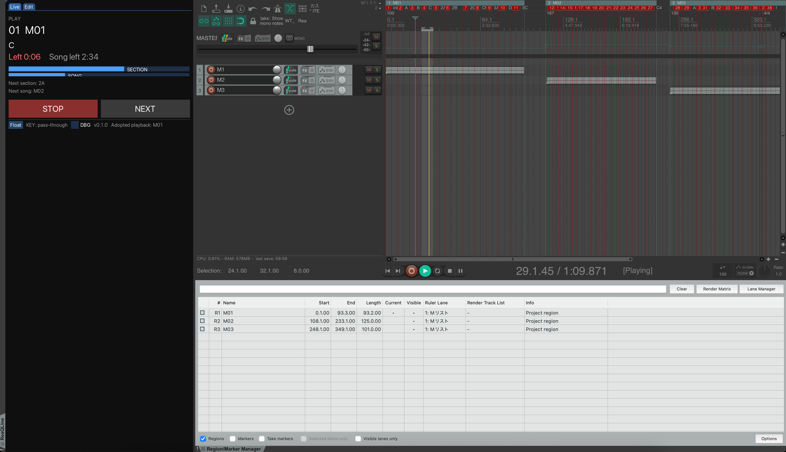
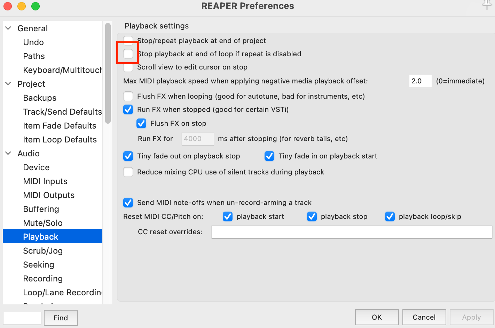
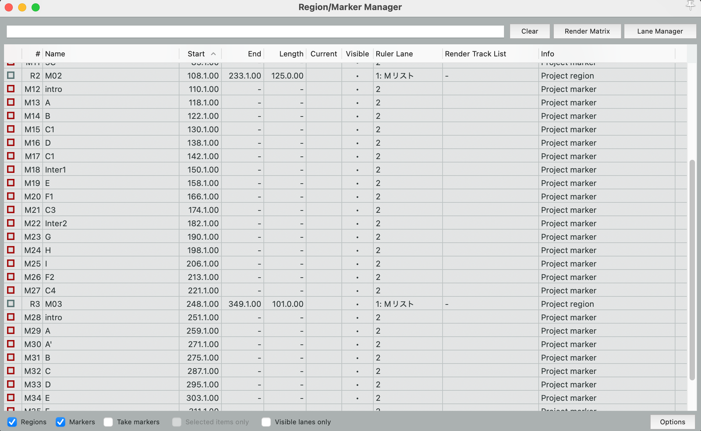
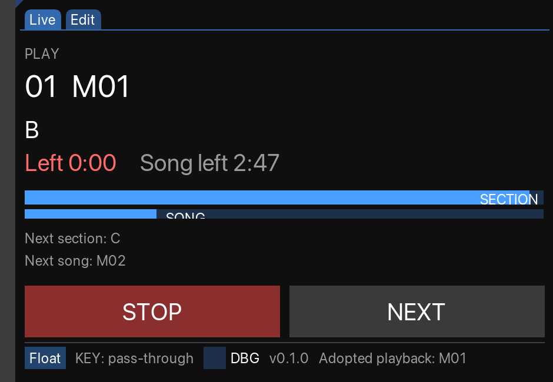
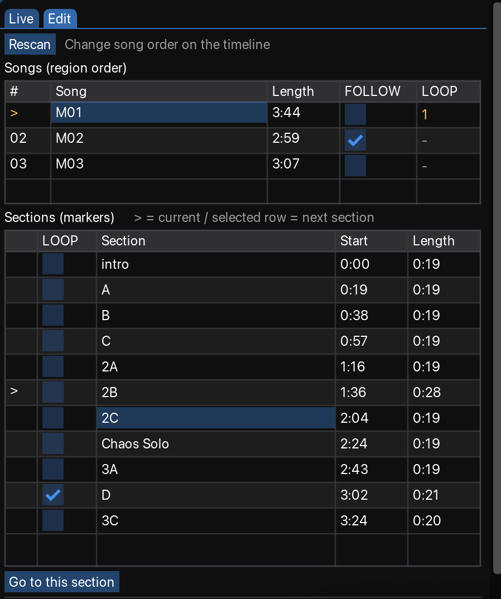

# ReaQLine

**English** | [日本語](README.ja.md)

A live set / cue controller that runs entirely inside REAPER.

Regions are your **songs**, markers are your **sections**. ReaQLine reads them straight from the timeline and gives you a big, glanceable panel with three buttons: **GO**, **NEXT**, **STOP**. No browser, no external process, no extra setlist file to keep in sync.

[](LICENSE)
[-2f2f2f.svg)](https://www.reaper.fm/)
[](https://forum.cockos.com/showthread.php?t=250419)

<!-- IMAGE: Live tab during playback, ideally a short GIF/video of a song running -->


## Why ReaQLine

Playing backing tracks live with REAPER usually means staring at the arrange view and hunting for the right region. ReaQLine turns your existing project into a performance controller:

- **Nothing to re-enter.** Song order comes from where regions sit on the timeline. Sections come from markers. Rename or move things in REAPER and hit *Rescan*.
- **Section-accurate looping** driven by REAPER's own audio engine, so loops are sample-accurate and never drift.
- **Seamless song-to-song playback** with FOLLOW, including gapless transitions when regions are adjacent.
- **Your shortcuts keep working.** ReaQLine hands keyboard focus back to REAPER whenever you are not interacting with it, so every REAPER action and your foot switch behave as usual.
- **Readable from across the stage.** Fonts and buttons scale with the window width. Dock it or float it.

## Features

| | |
|---|---|
| **Live tab** | Current song, current section, time remaining, section/song progress bars, next section and next song. Big GO / NEXT / STOP buttons. |
| **Edit tab** | Song list (region order) and section table (markers) with per-song **FOLLOW** and per-section **LOOP** checkboxes. |
| **Auto stop** | Playback stops at the end of the region and the selection moves to the next song. Press GO to continue. |
| **Loop range tracking** | The loop range (time selection) always follows the section being played. Toggle repeat with REAPER's standard action to loop the current section. |
| **LOOP flag** | Sections marked LOOP turn repeat on automatically when entered. |
| **FOLLOW flag** | Songs marked FOLLOW start automatically when the previous one ends. Gapless if the regions touch. |
| **Adopts external playback** | If playback starts from REAPER itself (space bar, foot switch, MIDI), ReaQLine figures out which song is playing and takes over. |
| **Keyboard pass-through** | All REAPER shortcuts remain usable while the ReaQLine window is open. |
| **Per-project settings** | LOOP and FOLLOW flags are stored in the project file and keyed by name, so they survive moving regions and markers. |

## Requirements

Install both from ReaPack (ReaTeam Extensions):

- **ReaImGui** v0.9 or later
- **js_ReaScriptAPI** — required for keyboard pass-through

If either is missing, ReaQLine shows a message on launch and exits.

## Installation

1. Download or clone this repository.
2. Put `ReaQLine.lua` and the `reaqline/` folder **side by side** in your REAPER resource path, for example:

   ```
   <REAPER resource path>/Scripts/QuanTRIOS/
   ├── ReaQLine.lua
   └── reaqline/
   ```

   You can open the resource path from **Options > Show REAPER resource path**.
3. In REAPER, open **Actions > Show action list**, click **New action… > Load ReaScript…** and pick `ReaQLine.lua`. The `reaqline/` folder does not need to be registered.
4. *(Optional)* Copy the PNGs in `toolbar_icons/` to `<resource path>/Data/toolbar_icons/`. Restart REAPER, right-click a toolbar button and choose **Change icon**. Use the `_x2` variant on HiDPI displays.

### One REAPER setting you must change

Open **Preferences > Audio > Playback** and turn **OFF**:

> Stop playback at end of loop if repeat is disabled

If this is on, REAPER stops the moment you leave a loop instead of continuing into the next section.

<!-- IMAGE: Preferences > Audio > Playback with the checkbox highlighted -->


## Preparing your project

ReaQLine does not keep its own setlist. It reads the timeline:

<!-- IMAGE: REAPER arrange view with a few regions (songs) and markers (sections) inside them -->


| Timeline element | Meaning in ReaQLine |
|---|---|
| **Region** | A song. Song order = order on the timeline. |
| **Marker inside a region** | A section (Intro, A, B, Chorus…). A section ends at the next marker, or at the region end. |
| **Marker outside any region** | Ignored. |

Rules to keep in mind:

- Regions must **not overlap**.
- Region names must be **unique**, and section names must be unique **within a song**. Settings are keyed by these names.
- After a song **without** FOLLOW, leave about **1 second of silence** at the end of the region. End-of-song detection can run up to one frame (~30 ms) late.
- To change song order, move the regions in REAPER and click **Rescan** in the Edit tab.

## Using ReaQLine

### Live tab

<!-- IMAGE: Live tab, annotated if possible (song name / section / remaining / bars / buttons) -->


| Button | What it does |
|---|---|
| **GO** | Plays the selected song from the beginning. Stops automatically at the region end. |
| **NEXT** | Turns repeat off. No seek: playback simply runs past the section end into the next section. Equivalent to REAPER's *Transport: Toggle repeat*. |
| **STOP** | Stops immediately. While playing, GO turns into STOP. |

The panel also shows the transport state (PLAY / PAUSE / REC / STOP), the current section with time remaining, time remaining in the song, and the next section and next song. Remaining times turn red in the last 10 seconds.

### Edit tab

<!-- IMAGE: Edit tab showing the song list with FOLLOW/LOOP columns and the section table -->


- **Song list** (left / top): every region in timeline order, with its length, a **FOLLOW** checkbox and the number of LOOP sections. Double-click a song to start it.
- **Section table** (right / bottom): markers of the selected song with start offset and length, plus a **LOOP** checkbox per section. `>` marks the section currently playing, `@` marks an active loop. Double-click a section, or use *Go to this section*, to seek there.
- **Rescan** re-reads regions and markers after you edit the timeline.

The layout switches between side-by-side and stacked depending on the window width.

### Looping a section

ReaQLine continuously sets REAPER's loop range (time selection) to the section that is playing. It does **not** touch the repeat button on its own.

To loop the section you are in, press REAPER's standard **Transport: Toggle repeat** action. Press it again to leave the loop and continue. Assign your foot switch or MIDI controller to that standard action; there is nothing to map to ReaQLine itself.

Because REAPER's audio engine performs the loop, it is sample-accurate.

<!-- VIDEO/GIF (optional): looping a section with Toggle repeat, then leaving the loop -->

Sections with the **LOOP** flag turn repeat on automatically when entered. Sections without the flag never change repeat, so manual control and the flag never fight each other.

### FOLLOW (auto-continue to the next song)

Check **FOLLOW** on a song in the Edit tab and it starts automatically when the previous song ends.

- Regions **adjacent** on the timeline: playback continues without a seek. Gapless.
- Regions **with a gap**: ReaQLine seeks to the start of the next song and continues.

FOLLOW on the first song has no effect; ReaQLine shows a `!` to point that out.

### Selection follows playback

While playing, the selection follows the play position. While stopped, it follows the edit cursor and the time selection. This cannot be disabled.

In the section table, the highlighted row is the **next** section and `>` is the **current** one, so you can read both at a glance.

## Where settings are stored

| Setting | Stored in |
|---|---|
| LOOP flags, FOLLOW flags | The project (`SetProjExtState`) |
| Dock state | Global (`SetExtState`) |

Settings are keyed by song name and section name, so moving regions or markers on the timeline keeps them. Renaming a region or marker resets its settings.

## Troubleshooting

- Turn on **DBG** in the footer to see the internal state. The `KB` line reports how keyboard settings were applied; the `DBG` line shows the tracking source, play position, region end and selection.
- **Japanese region or marker names show as boxes**: update ReaImGui, or use romanized names.
- **Playback stops when leaving a loop**: check the preference described in [One REAPER setting you must change](#one-reaper-setting-you-must-change).
- **Playback stops at end of song even with FOLLOW**: make sure the next region is adjacent, or that no other region overlaps it.

## Project layout

<details>
<summary>Source files</summary>

```
ReaQLine.lua           Entry point. Owns the shared state and wires the modules.
reaqline/
  config.lua           Constants and colors
  imgui.lua            ReaImGui setup, fonts, keyboard handling
  model.lua            Project scanning, saving and restoring flags
  transport.lua        Playback control, loop range, song progression
  widgets.lua          Shared drawing helpers
  ui_live.lua          Live tab
  ui_edit.lua          Edit tab
  ui.lua               Window frame, docking, focus return
```

Thresholds, colors and font sizes live only in `config.lua`.

</details>

## Changelog

See [CHANGELOG.md](CHANGELOG.md).

## License

[MIT License](LICENSE)
